<div align="center">


<br/>

<a href="https://orbit.krd">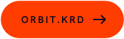</a>
<a href="https://orbit.krd/core"></a>
<a href="https://www.linkedin.com/in/aland-omed-a17956348/"></a>
<a href="https://github.com/aland-omed"></a>
<a href="mailto:aland.omed.mohammed@gmail.com"></a>
<a href="https://main.codecommerce.info/"></a>

</div>

<br/>

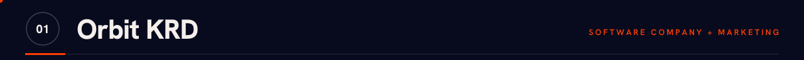

**ئەلەند ئومێد** · I'm Aland Omed, a computer engineer from the Kurdistan Region of Iraq and the founder of **Orbit KRD**.

**Orbit KRD is a software company and marketing agency.** We create every type of system, software and application, and we run the marketing side too: the plans, the content, the brand and the film. **Orbit Core** is a part of Orbit KRD: the till, dining and retail systems and the apps around them.

<div align="center">
</div>

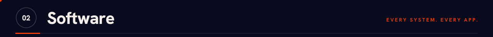

We are a software company. If a business needs it to run on a screen, we build it, in English, Kurdish and Arabic, with real right-to-left layouts.

<div align="center">
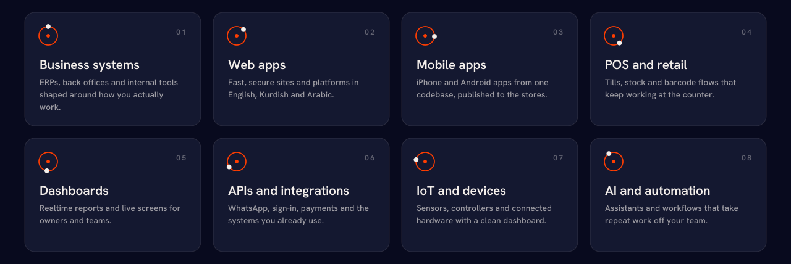
</div>

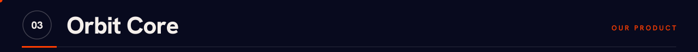

**Orbit Core** is a part of Orbit KRD: the systems and apps we built for venues. One multi-tenant platform runs a business end to end: the till at the counter, the screens in the kitchen, the page a guest finds, the app they order from and the points they earn. Every venue is a tenant with one vertical and only the add-ons it needs.

<div align="center">
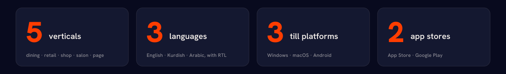
</div>

| Layer | What it does |
|---|---|
| **Dining** | POS, tabs, table ordering from the Orbit app, kitchen, bar and shisha station screens, waiter "ready" push, drawer and shift statements |
| **Retail** | Apparel and barcode POS with a stock ledger |
| **Online shop** | Orders from the Orbit app with the shop's own delivery, plus a themed shop page per brand |
| **Salon** | Bookings, a salon till and a phone-first flow |
| **Venue pages** | A page and QR for any venue, with or without a till |
| **Money** | Cash drawer open and close, cash-out kinds, hand-over and printable statements |
| **Network** | One Orbit Points currency, stamp cards and offers across venues |
| **Stock · Discounts** | Track-in-stock menu items and rule-based discounts with manager approval |
| **Play** | Word and puzzle games and match predictions inside the Orbit app |
| **Orbit Control** | The platform cockpit for onboarding, billing and app releases |

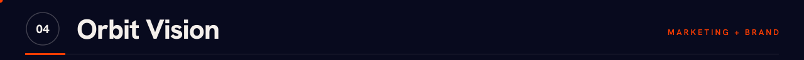

**Orbit Vision** is the marketing and brand side of the agency. It plans, writes, designs and films, so the software we build gets seen and the brands we work with look like they mean it.

<div align="center">
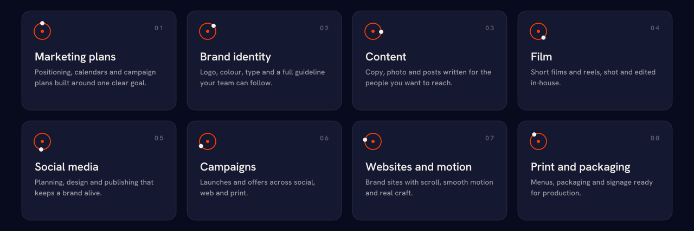
</div>

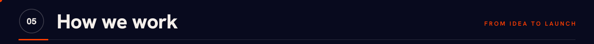

<div align="center">
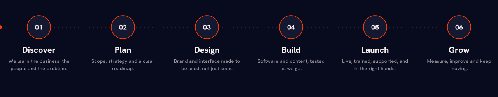
</div>

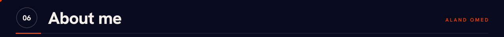

<table>
  <tr>
    <td width="60%" valign="top">

```yaml
name: Aland Omed  # ئەلەند ئومێد
role: Founder, Orbit KRD · Computer Engineer
location: Kurdistan Region of Iraq
languages: [English, کوردی (سۆرانی), العربية]
agency:
  - Software          # systems, apps, APIs, IoT, AI
  - Orbit Core        # till, dining, retail, venue platform
  - Orbit Vision      # plans, content, brand, film
focus:
  - Full stack products people use all day
  - Realtime and offline-safe systems
  - Brands and content that match the product
values:
  - Calm interfaces, clear code
  - Reliability before features
  - Real-world impact
```

</td>
    <td width="40%" valign="top">

**Shipping lately**

- Orbit app on the App Store and Google Play
- Salon and online-shop verticals
- Orbit Network: one points currency across venues
- Orbit Play: games and predictions
- Money add-on with drawer and statements
- A new Orbit KRD website and brand kit

**Open to**

- Software and marketing projects
- Collaboration and open source
- Technical talks and mentoring

</td>
  </tr>
</table>


<div align="center">
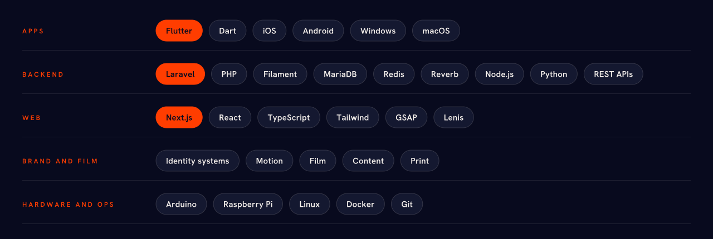
</div>

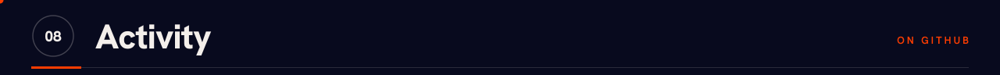

<div align="center">

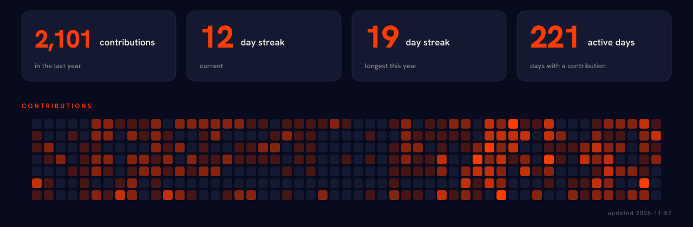

<br/>

<picture>
  <source media="(prefers-color-scheme: dark)" srcset="https://raw.githubusercontent.com/aland-omed/aland-omed/output/github-contribution-grid-snake-dark.svg" />
  <source media="(prefers-color-scheme: light)" srcset="https://raw.githubusercontent.com/aland-omed/aland-omed/output/github-contribution-grid-snake.svg" />
  
</picture>

</div>

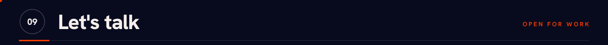

Running a café, restaurant, salon, shop or brand and want it on one clean system? Need an app or system, a marketing plan or a brand people remember? Tell me what you are building and I will read every message.

<div align="center">

<a href="mailto:aland.omed.mohammed@gmail.com">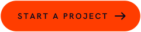</a>
<a href="https://orbit.krd"></a>

<br/><br/>


</div>
